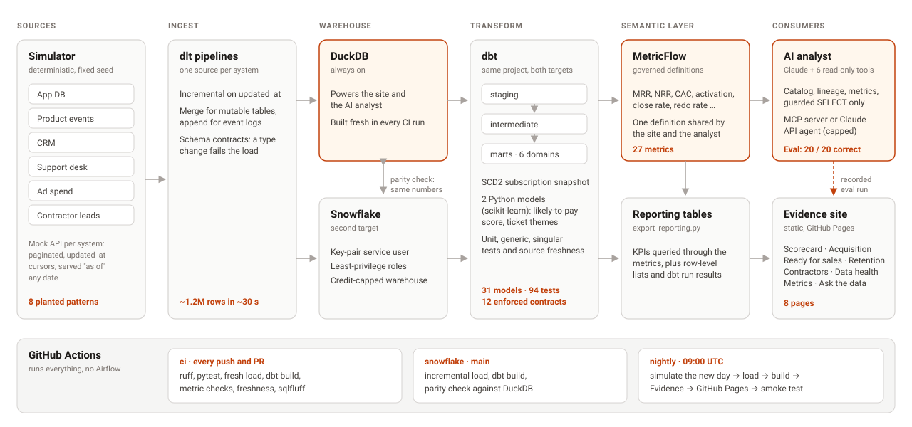

# Ridgeline Analytics

The analytics platform of **Ridgeline**, a fictional SaaS company that sells software to roofing contractors. It covers the full path from source systems, through ingestion and a tested dbt model, to the metrics a revenue, product and customer team would use.

> **All data is synthetic.** A deterministic simulator ([saas-world-sim](https://github.com/sky-five/saas-world-sim), pinned to a tag) generates it, with business patterns planted on purpose (listed below). No real company's data or code is used.

**Live site:** https://sky-five.github.io/ridgeline-analytics/ (rebuilt every night from a fresh simulated day)

**Status:** Phases 1–4 of 5 are done. The same dbt project builds on **DuckDB and Snowflake** (identical numbers), tested in CI on both. A MetricFlow semantic layer feeds the Evidence site, which a nightly GitHub Actions job rebuilds and publishes. An AI analyst answers questions over the same metrics; its recorded eval is on the site's Ask the data page. See the [roadmap](#roadmap).

## Architecture



| Layer | What it does |
|---|---|
| [`saas-world-sim`](https://github.com/sky-five/saas-world-sim) (installed package) | Deterministic history of six systems: app DB, product events, CRM, support desk, ad spend, and contractors' own homeowner leads. Served "as of" any date through a paginated mock API with `updated_at` cursors. |
| `pipelines/` | One dlt source per system. Incremental on `updated_at`, merge for mutable tables, append for logs, schema contracts that freeze data types. Loads about 1.2M rows in ~30s. |
| `dbt/` | Staging → intermediate → six domain mart folders. 31 models (29 SQL, 2 Python), 12 with enforced contracts, 94 tests. |

## Data model (marts)

| Domain | Model | Grain | Answers |
|---|---|---|---|
| finance | `fct_mrr_movements` | subscription change | New, expansion, contraction, churn, reactivation |
| finance | `fct_mrr_daily` | day | Company MRR and paying accounts every day |
| finance | `dim_accounts` | account | Current plan, MRR, churn date and reason |
| growth | `fct_account_funnel` | account | First-14-day behaviour, activation, paid within 60 days |
| growth | `fct_marketing_channel_daily` | day × channel | Spend, signups, conversions, trailing-90-day CAC |
| growth | `fct_cohort_retention` | cohort × month | Logo retention, NRR, GRR |
| sales | `fct_pqa_scores` | account | Likelihood to pay (dbt **Python** model, scikit-learn), with reasons |
| sales | `fct_rep_followups` | top-decile account | Did a rep call within 3 days? |
| customer_success | `fct_support_tickets` | ticket | Reply and resolution times, churn theme |
| customer_success | `fct_ticket_themes` | ticket | Theme from hand labels + classifier (dbt **Python** model) |
| customer_success | `fct_account_health` | paying account | Rule-based health score and risk band |
| contractor_outcomes | `fct_contractor_leads` | homeowner lead | Speed to lead in minutes, outcomes that don't overlap |
| contractor_outcomes | `fct_contractor_benchmarks` | contractor × month | Close rate and speed vs crew-size peers |
| ops | `fct_measurement_quality` | measurement order | Turnaround and redo rate |

## How it's tested

| Kind | Count | Examples |
|---|---|---|
| dbt generic tests | 80 | Keys, accepted values, relationships, `dbt_utils` range and combination checks |
| dbt unit tests | 9 | MRR movement types and month boundaries, the 60-day paid cutoff, early signals stopping at first payment (no leakage), CAC using only cohorts with a known outcome, rep follow-ups, health-score rules, speed-to-lead buckets, peer ranks |
| dbt singular tests | 5 | Every subscription invoice equals the MRR log at issue time. Last-day MRR ties to the sum of accounts. The score's top decile beats average by ≥2.5× on held-out data. One current snapshot row per subscription. Ticket-theme classifier holds its accuracy on held-out labels. |
| Model contracts | 12 marts | Column names and types are enforced at build time |
| Source freshness | 11 tables | Time since the last successful pipeline load: warn after 36h, error after 72h |
| pytest | 41 | Simulator determinism, history stable across dates, planted patterns present, API paging, dlt idempotency and merge behaviour |

## What the data shows (as of 2026-10-07)

| Finding | Number |
|---|---|
| MRR / paying accounts | $243.7k / 779 |
| Accounts that send a proposal in their first 14 days | convert 39% vs 5% (~8×) |
| Top 10% by score, on 2026 signups the model never saw | 59% convert vs 16% average (3.7×) |
| Homeowner leads contacted in under 5 minutes | close 39% vs 20% at 5–60 minutes |
| Leads worked but with no first-contact time logged | 7%, a data-quality gap the dashboards must show |
| 12-month NRR | 61% (SMB churn is heavy, so retention is a key lever) |

## Planted patterns

These were built into the simulator so the analysis has something real to find:
- Channel quality differs: referral and supplier-partner signups convert best, Facebook worst.
- Sending a proposal in week 1 is the strongest upgrade signal.
- Bigger crews convert more, choose the higher plan and churn less.
- Storm season (Apr–Aug) brings more signups and leads.
- Contractors who answer leads in under 5 minutes close about 2× as often.
- Measurement-report redos lead to support tickets and raise churn.
- About 8% of lead stage times are never logged.
- Churn reasons are written in the support-ticket text.

## Where the data comes from

The simulated business used to live in a `simulator/` folder here. It is now its own package, [saas-world-sim](https://github.com/sky-five/saas-world-sim), so other demos can use the same engine. This repo installs it from git at a pinned tag (`v0.4.0`, in `requirements.txt`) and imports it in one place, `pipelines/engine.py`. The full seeded history is still cached in `.cache/` at the repo root.

Moving it did not change any number. Before the switch, the old folder and the package gave identical tables (every column, every row) as of 2024-03-01, 2025-07-15, 2026-06-30, 2026-11-02 and 2026-11-07, which is 1,245,216 rows on the last date. `tests/test_engine_pin.py` keeps it that way: it fails if `requirements.txt`, the engine tag and the installed version disagree, or if the 2026-06-30 row counts and invoice and MRR totals move. The engine's own unit tests and fingerprint tests run in its repo.

## AI analyst (Phase 4)

An agent that answers business questions from the warehouse the way an analytics engineer would: find the right mart, read its definition, prefer the governed metric, run read-only SQL, and cite where the number came from. `analyst/` holds it.

| Piece | What it does |
|---|---|
| `catalog.py` | Reads dbt's `manifest.json` and `semantic_manifest.json`: search, columns, tests, contracts, lineage back to the raw sources, and the mart each metric is built on |
| `sql_guard.py` | Read-only at three levels: the DuckDB file opens `read_only`, the session turns off file and network access and locks its settings, and every statement must parse as a single `SELECT`. Rows and run time are capped |
| `tools.py` | Six tools: `search_catalog`, `describe_model`, `get_lineage`, `list_metrics`, `query_metric`, `run_sql`. Metric queries are compiled by MetricFlow and run through the same guard, so the agent's numbers match the dashboards |
| `server.py` | MCP server over stdio, so Claude Code, Claude Desktop or any MCP client can use the tools |
| `agent.py`, `llm.py` | The same tools as an API agent, capped at 12 model calls and 300k tokens per question. The model client is pluggable: Claude (`claude-opus-5-5` by default) or Gemini's free tier (`--provider gemini`) |
| `evals/` | 20 questions with answers computed from the marts at run time, scored for correctness (0.5% or half a point) and grounding (did it cite the right mart) |

```bash
claude mcp add ridgeline -- .venv/Scripts/python -m analyst.server     # use it from Claude Code
.venv/Scripts/python -m analyst.agent "What was MRR at the end of September 2026?"
.venv/Scripts/python -m analyst.evals.run --backend claude-code        # or --backend api
```

The eval questions cover governed metrics, ad hoc SQL with the right filters (mature signups only, open leads excluded), lineage, and one question the warehouse can't answer, where the right reply is "no data" rather than a guess.

**First run (2026-10-30, data as of 2026-10-29, Claude Code headless with the MCP server):**

| Result | Number |
|---|---|
| Correct answers | 20 / 20 |
| Cited the right mart | 20 / 20 |
| Answered through a governed metric | 15 / 20 |
| Median time / tool calls per question | 28 s / 5 |
| Cost at API rates, all 20 questions | $3.66 |

For the NPS question it searched every table and column for survey data, found none and returned no number. Full transcripts: `analyst/evals/results/`. These questions state their definitions; the next eval adds vaguer questions ("how are we doing on retention?") where choosing the definition is the hard part.

## Semantic eval: raw tables vs governed metrics

`semantic_eval/` is a test set for one question: is an AI analyst more reliable when it can only use governed metrics? 25 business questions, worded the way a stakeholder would ask them, each with an answer computed from the MetricFlow metrics and a note on the mistake a raw-table query tends to make (summing daily MRR, counting signups too young to judge, dividing by open leads). Answers about closed periods are checked on every CI build.

The analyst answered each question twice, once with only the raw loaded tables and once with only the governed metrics. **Governed metrics: 25 / 25 correct. Raw tables: 17 / 25.** Revenue questions were right either way; the raw misses were all definition questions (trial-to-paid, activation, lead close rate, CAC, NRR), where it picked its own definition and returned a confident number. The recorded run replays without an API key. Details: [semantic_eval/README.md](semantic_eval/README.md).

```bash
.venv/Scripts/python -m semantic_eval.answer_key
.venv/Scripts/python -m semantic_eval.run --replay semantic_eval/results/raw-vs-governed-2026-11-03.json
```

## ARR and revenue recognition

`revrec/` is a separate module on its own synthetic Stripe-shaped billing data: monthly and annual plans, prorated upgrades, refunds, seat changes and churn. It builds ratable revenue by day, a deferred revenue rollforward and a per-customer ARR bridge in DuckDB SQL. A separate Python calculation then has to match every number to the cent (201 of them), and a test plants an error to show the check catches it. Details: [revrec/README.md](revrec/README.md).

```bash
.venv/Scripts/python -m revrec
```

## A/B test analysis

`experiments/` is a learning project on simulated data: an onboarding experiment (a guided setup checklist vs the current flow) with a planted true lift of 4 points on 30% activation. It plans the sample size (2,131 per arm), reads out the test with a 95% interval, checks the traffic split for a sample-ratio mismatch (and catches a planted tracking bug that would have doubled the apparent lift), and shows with 2,000 A/A tests why stopping at the first significant day is a mistake (5.1% false positives testing once, 25.6% testing daily). The site's [A/B test page](https://sky-five.github.io/ridgeline-analytics/experiments) shows the readout. Details: [experiments/README.md](experiments/README.md).

```bash
.venv/Scripts/python -m experiments
```

## Orchestration with Airflow

`orchestration/` is a learning project on simulated data: the nightly build as one Airflow 3 DAG (load, dbt build, reporting refresh, warehouse tests and source freshness, then a last-good-build marker), with retries and backoff, a failure alert callback and a backfill example. A separate workflow runs DAG integrity tests and one full `airflow dags test` run on every change; the GitHub Actions nightly still publishes the site. Details: [orchestration/README.md](orchestration/README.md).

## Sales CRM data model

`crm_pipeline/` is a learning project on simulated data. It takes the standard CRM objects from saas-world-sim's sales CRM pack (leads, accounts, contacts, opportunities, opportunity history) and models them in a small dbt project on DuckDB: pipeline coverage, stage conversion, sales velocity and a quarter-start forecast back-tested over 9 quarters. The pack's duplicate accounts and backdated close dates are fixed in the models and scored against labels the warehouse never sees. As of 2026-06-30, the models find 60 of 61 duplicates and all 9 backdated deals closed by then, with no false matches. Stage win rates learned from history cut the forecast error from 27.1% to 19.6%. There are also four SOQL-style example queries, each with a SQL version that runs. Details: [crm_pipeline/README.md](crm_pipeline/README.md).

## Snowflake

Run `infra/snowflake/setup.sql` once as ACCOUNTADMIN (it replaces `<PUBLIC_KEY>` with your key's public half), put the dlt credentials in `.dlt/secrets.toml`, then:

```bash
python -m pipelines.run --destination snowflake
cd dbt && SNOWFLAKE_PRIVATE_KEY_PATH=~/.ridgeline/rsa_key.p8 dbt build --profiles-dir . --target snowflake
python scripts/compare_targets.py   # same numbers on both warehouses
```

## Run it

```bash
uv venv --python 3.12 .venv
uv pip install --python .venv/Scripts/python.exe -r requirements.txt   # macOS/Linux: .venv/bin/python
.venv/Scripts/python scripts/run_all.py --fresh                          # simulate → load → dbt build
.venv/Scripts/python -m pytest -m "not e2e"                              # Python tests
```

`run_all.py` loads data as of yesterday by default. `--as-of YYYY-MM-DD` picks a date between 2024-03-01 (before that, some systems have no rows yet) and 2027-12-31 (the end of the simulated history). The same date always gives the same data. Use `--fresh` when moving to an earlier date. The first run simulates the full history (about a minute) and caches it in `.cache/`.

## Repo map

```
pipelines/   dlt sources + load CLI; engine.py imports the pinned saas-world-sim package
dbt/         models/{staging,intermediate,marts/*}, tests/, seeds/, macros/ (cross-database helpers)
semantic_eval/ business questions, governed-metric answer key, raw-vs-governed eval and its recorded run
orchestration/ Airflow DAG for the nightly build, failure alerts, last-good marker (learning project)
experiments/ simulated A/B test: sample size, readout, SRM check, peeking demo (learning project)
crm_pipeline/ sales CRM objects in dbt: dedupe, close-date fixes, coverage, velocity, forecast back-test (learning project)
revrec/      ARR bridge, ratable revenue and deferred revenue on synthetic billing, with a parallel-run check
scripts/     run_all.py, compare_targets.py (DuckDB vs Snowflake parity)
tests/       pytest suites
docs/        design spec and implementation plans
```

## Roadmap

1. ✅ Simulator, dlt, dbt on DuckDB, tests, CI
2. ✅ Snowflake as a second target (key-pair service user, least-privilege roles, credit-capped warehouse: `infra/snowflake/setup.sql`), with its own CI job and a DuckDB parity check. SCD2 snapshot of subscriptions. Support-ticket churn themes come from 300 tickets labelled by Claude Code plus a TF-IDF classifier (100% on held-out labels). Snowflake Cortex `AI_CLASSIFY` is blocked on trial accounts, so it sits behind a `use_cortex` flag for paid accounts.
3. ✅ MetricFlow semantic layer (27 governed metrics), Evidence site (scorecard, acquisition, ready for sales, data health, metric definitions), nightly simulate → load → build → deploy to GitHub Pages with a smoke test
4. ✅ AI analyst: MCP server, read-only SQL guard, Claude API agent with spending caps, 20-question eval, shown on the site's "Ask the data" page as a recorded run (no live LLM calls). Retention and contractor outcome pages
5. Polish: architecture diagram, demo video

## Notes

Built by Shubham Yadav with Claude Code as a pair programmer. I set the design, metrics and checks, and reviewed every number.
